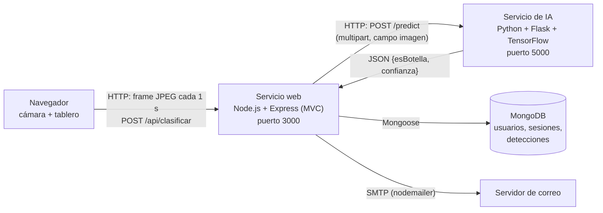
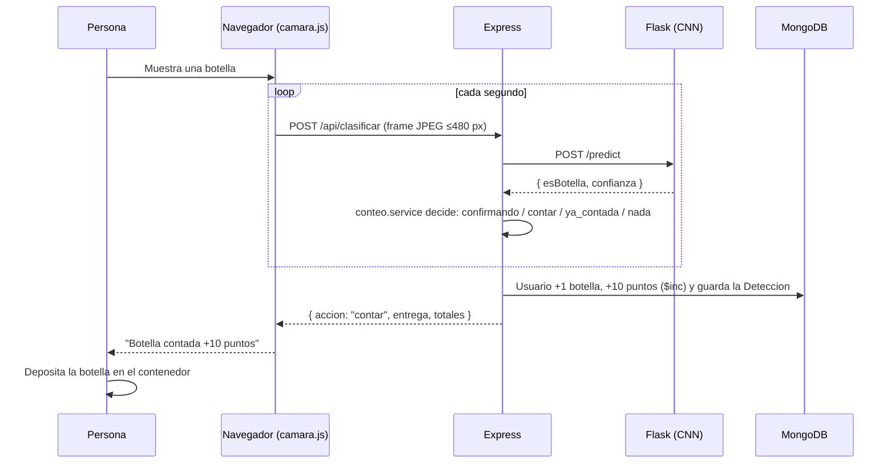
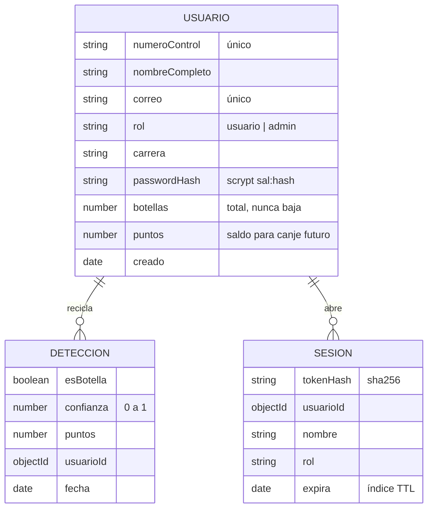
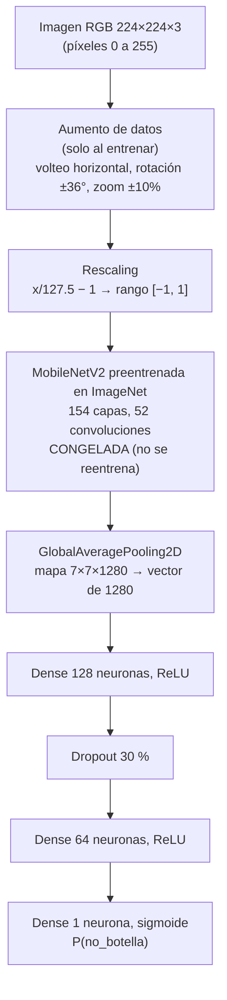

# Reciclaje Neurona: reporte del proyecto y guion de presentación

Este documento tiene dos partes:

- **Parte A. Reporte técnico:** cómo está construido el proyecto, qué es cada pieza y qué función cumple.
- **Parte B. Guion de presentación:** cómo presentarlo en tres secciones: *Inteligencia artificial*, *Infraestructura de servicios digitales* e *Interacción con servicios digitales*.

> **Sobre los datos del entrenamiento.** La información de la red neuronal se obtuvo del propio archivo del modelo (`ia-service/modelo/botellas.keras`), que guarda la arquitectura, el optimizador, la función de pérdida y las capas de aumento de datos. Los datos que **no** están dentro del modelo (cuántas imágenes se usaron, cuántas épocas y la precisión final) vienen del cuaderno o script de entrenamiento en `C:\proyecto_botellas`, que no se pudo revisar. Esos huecos están marcados con **[COMPLETAR]**.

---

# Parte A. Reporte técnico

## 1. Qué hace el sistema

Es una aplicación web para una **recicladora**. Una persona inicia sesión y pone una botella frente a la cámara. Una **red neuronal convolucional** decide si el objeto es una botella de plástico. Cada botella se cuenta **una sola vez** y suma **puntos** a esa persona. Los puntos quedan guardados para un futuro sistema de canje de premios, que todavía no está implementado.

## 2. Arquitectura general

El sistema son **tres servicios** que se comunican por red:



| Servicio | Tecnología | Responsabilidad |
|---|---|---|
| Cliente | HTML + CSS + JavaScript sin framework | Captura la cámara, envía frames, muestra el veredicto, los puntos y el historial |
| Web | Node.js, Express, Handlebars, Mongoose | Login, sesiones, reglas del conteo, puntos, reportes PDF, correo, panel de administrador |
| IA | Python, Flask, TensorFlow/Keras | Carga la red neuronal y clasifica cada imagen |
| Base de datos | MongoDB (local o Atlas) | Guarda usuarios, sesiones y cada botella contada |

## 3. Flujo de una botella, paso a paso



**¿Por qué existe la regla del conteo?** La cámara manda un frame por segundo, así que una botella que se queda 10 segundos frente a la cámara aparecería en 10 frames. El archivo `conteo.service.js` funciona como un semáforo por persona:

1. La botella debe verse en **2 frames seguidos** con al menos **80 % de seguridad**. Entonces se cuenta.
2. Mientras siga frente a la cámara, **no vuelve a sumar**.
3. Para contar otra, la cámara debe dejar de ver botella durante **3 frames seguidos**, es decir, la persona la retiró o la depositó. Además pasan al menos **3 segundos** entre una botella y otra.

Todos estos valores se configuran en `web/.env`.

## 4. Estructura de carpetas y función de cada archivo

### 4.1 Raíz del proyecto

| Archivo | Función |
|---|---|
| `README.md` | Instrucciones de instalación y lista de la API |
| `CLAUDE.md` | Guía técnica del proyecto (arquitectura, comandos, convenciones) |
| `.claude/skills/` | Guías especializadas: el modelo, la API, el arranque local y el diseño |
| `.gitignore` | Excluye `.env`, `node_modules`, `venv` y cachés de Python |
| `docs/REPORTE-PROYECTO.md` | Este documento |

### 4.2 `ia-service/`: servicio de inteligencia artificial

| Archivo | Función |
|---|---|
| `app.py` | Servidor Flask. Al arrancar carga el modelo **una sola vez**. Expone `GET /health` (¿está vivo?) y `POST /predict`, que recibe una imagen, la convierte a RGB 224×224 y devuelve `{ esBotella, confianza }` |
| `modelo/botellas.keras` | La red neuronal entrenada (~11 MB): arquitectura y pesos |
| `requirements.txt` | Dependencias: `flask`, `tensorflow==2.21.0`, `pillow`, `numpy` |

### 4.3 `web/`: servicio web (patrón Modelo-Vista-Controlador)

```
web/src/
├── app.js            ← punto de entrada: configura Express y conecta MongoDB
├── config/           ← configuración (BD, sesión, roles)
├── models/           ← MODELO: datos y reglas de MongoDB
├── views/            ← VISTA: plantillas HTML (Handlebars)
├── controllers/      ← CONTROLADOR: recibe la petición y decide qué responder
├── routes/           ← asocia cada URL con su controlador
├── middleware/       ← filtros que corren antes de los controladores (sesión, admin)
├── services/         ← lógica que habla con el exterior (IA, correo) o reglas de negocio
├── utils/            ← utilidades (contraseñas, cookies, PDF)
├── public/           ← archivos que descarga el navegador (CSS, JS)
└── assets/fuentes/   ← tipografías para los PDF
```

**Configuración (`config/`)**

| Archivo | Función |
|---|---|
| `db.js` | Conecta a MongoDB con `MONGODB_URI` e informa si la conexión está activa |
| `sesion.js` | Tiempo de inactividad que cierra la sesión (`SESION_INACTIVIDAD_SEG`, 60 s por defecto) y nombre de la cookie |
| `admin.js` | Roles (`usuario` y `admin`) y verificación del código secreto para registrar administradores (`ADMIN_CODIGO`) |

**Modelos (`models/`)**

| Archivo | Colección | Función |
|---|---|---|
| `usuario.model.js` | `usuarios` | Número de control, nombre, correo, rol, carrera, contraseña cifrada y los totales **`botellas`** y **`puntos`**. Funciones: crear, autenticar, listar, `sumarBotella` (suma atómica con `$inc`), `totales` y la migración `completarTotales` |
| `deteccion.model.js` | `deteccions` | **Una botella contada**: confianza, puntos, usuario y fecha. Funciones: guardar, listar, resumen, botellas por día y conteo por usuario |
| `sesion.model.js` | `sesions` | Sesiones activas. Solo guarda el **hash** del token. Un índice TTL hace que MongoDB borre solas las sesiones vencidas |

> Las colecciones las nombra Mongoose a partir del modelo (`Deteccion` → `deteccions`). Puedes comprobar los nombres exactos en Atlas o con `mongosh`.

**Controladores (`controllers/`)**

| Archivo | Función |
|---|---|
| `auth.controller.js` | Login, registro (con validaciones), logout y *ping* de actividad. Envía el correo de bienvenida |
| `vista.controller.js` | Muestra el tablero con los datos de la sesión |
| `clasificacion.controller.js` | Recibe el frame, consulta a la IA, aplica la regla del conteo y, si es una botella nueva, suma los puntos y guarda la detección. También entrega el historial, el resumen y el estado de los servicios |
| `reporte.controller.js` | Genera la **constancia** PDF y la envía por correo al usuario (máximo una por minuto). Genera el **reporte estadístico** PDF para el administrador |
| `admin.controller.js` | Panel de administrador: usuarios, filtros, totales, PDF de la lista de usuarios y eliminación de usuarios |

**Rutas (`routes/`)**

| Archivo | URLs |
|---|---|
| `auth.routes.js` | `/login`, `/registro`, `/logout`, `/auth/ping` |
| `view.routes.js` | `/` (tablero; requiere sesión) |
| `api.routes.js` | `/api/estado` (pública); `/api/clasificar`, `/api/historial`, `/api/resumen` y `/api/constancia` (requieren sesión) |
| `admin.routes.js` | `/admin`, `/admin/usuarios.pdf`, `/admin/usuarios/:id/reporte.pdf`, `/admin/usuarios/:id/eliminar` (solo administradores) |

**Middleware, servicios y utilidades**

| Archivo | Función |
|---|---|
| `middleware/auth.js` | Lee la cookie y carga la sesión. Protege vistas (redirige al login), APIs (responde 401) y el panel de admin (responde 403) |
| `services/ia.service.js` | **Único** punto que habla con Flask: envía la imagen y verifica `/health` |
| `services/conteo.service.js` | Semáforo por persona que evita contar la misma botella varias veces |
| `services/correo.service.js` | Envía correos por SMTP con nodemailer: el aviso de registro y la constancia con el PDF adjunto |
| `utils/password.js` | Cifra contraseñas con **scrypt** y una sal aleatoria; compara en tiempo constante |
| `utils/cookies.js` | Lee las cookies de la petición |
| `utils/pdf.js` | PDF de tabla, escrito a mano y sin librerías (lista de usuarios del admin) |
| `utils/reporte-pdf.js` | PDFs con **pdfkit** y las tipografías del proyecto: `crearConstanciaPdf` (usuario) y `crearReportePdf` (admin, con gráfica y tabla) |

**Vistas y archivos del navegador**

| Archivo | Función |
|---|---|
| `views/layouts/main.hbs` | Plantilla base (cabecera HTML, fuentes, CSS) |
| `views/dashboard.hbs` | Tablero: cámara con la silueta de la botella, veredicto, marcador de puntos, botón de constancia e historial |
| `views/login.hbs`, `views/registro.hbs` | Formularios de acceso y registro (usuario o administrador) |
| `views/admin.hbs` | Panel del administrador |
| `public/js/camara.js` | Pide permiso a la cámara, toma un frame por segundo, lo envía, muestra el resultado y actualiza los puntos |
| `public/js/sesion.js` | Cierra la sesión tras un periodo sin actividad y muestra la cuenta regresiva |
| `public/css/estilos.css` | Diseño visual "estación de reciclaje": amarillo de contenedor de plásticos, gris de resto, tipografías Big Shoulders Display y Atkinson Hyperlegible |

## 5. Base de datos



- **Totales en `Usuario`:** se actualizan con `$inc`, una operación atómica, así que no se pierden puntos aunque lleguen dos peticiones a la vez.
- **Detalle en `Deteccion`:** permite el historial del tablero y la gráfica por día del reporte del administrador.
- **Registros antiguos:** los que se guardaban uno por frame no tienen puntos y se ignoran al contar.

## 6. Seguridad implementada

- **Contraseñas:** se guardan con scrypt y sal aleatoria, nunca en texto.
- **Sesiones:** token aleatorio de 32 bytes en una cookie `httpOnly` y `sameSite=lax`. En la base de datos solo se guarda su hash SHA-256, y vencen por inactividad.
- **Rutas protegidas:** las vistas, las APIs y el panel de administrador exigen sesión, y el panel además exige el rol `admin`.
- **Registro de administradores:** requiere un código secreto, que se compara en tiempo constante.
- **Imágenes:** la subida está limitada a 3 MB y solo acepta tipos `image/*`.
- **Correo de la constancia:** máximo un envío por minuto por persona.

## 7. Observaciones y pendientes detectados

1. **El canje de puntos por premios** está pendiente por decisión del equipo. Los puntos ya quedan guardados como saldo en `Usuario.puntos`.
2. **No hay pruebas automáticas, linter ni Docker.**
3. **Flask usa su servidor de desarrollo**, que atiende una petición a la vez. Para producción convendría `waitress` (Windows) o `gunicorn` (Linux).
4. **Dependencias declaradas que el código no usa:** `bcryptjs`, `connect-mongo` y `express-session` están en `package.json`, pero el código usa scrypt y sesiones propias. Lo mismo pasa con la variable `SESSION_SECRET` de `.env.example`. Se pueden quitar.
5. **Comentario desactualizado:** en `middleware/auth.js` se menciona `ADMIN_NUMEROS_CONTROL`, pero el rol de administrador se decide por el campo `rol` y el código `ADMIN_CODIGO`.
6. **Límite del modelo:** solo distingue "botella" de "no botella" y no reconoce botellas individuales. Si alguien retira la botella y la vuelve a mostrar, cuenta como otra. Por eso el flujo pide depositarla justo después del conteo.
7. **Estado del conteo en memoria:** reiniciar el servidor web reinicia el semáforo. No borra puntos.

---

# Parte B. Guion de presentación

Duración sugerida: **15 a 20 minutos** (5 a 6 minutos por sección) más una demostración de 3 minutos.

**Apertura (30 s):**
> "En una recicladora, contar a mano quién entrega cada botella es lento y se presta a errores. Construimos un sistema que, con una cámara y una red neuronal, reconoce botellas de plástico, cuenta cada una una sola vez y premia a quien recicla con puntos. Lo presentamos en tres partes: la inteligencia artificial que reconoce las botellas, la infraestructura que la sostiene y cómo se comunican los servicios."

---

## Sección 1. Inteligencia artificial

### 1.1 ¿Qué problema resuelve la IA?

Es un problema de **clasificación de imágenes binaria**: dada una foto, decidir entre dos clases, *botella* y *no botella*. Es **aprendizaje supervisado**: la red aprendió con imágenes ya etiquetadas por el equipo.

### 1.2 La neurona artificial

- **Qué hace:** una neurona artificial recibe varios números de entrada, multiplica cada uno por un **peso**, suma un **sesgo** y pasa el resultado por una **función de activación**: `salida = activación(w₁x₁ + w₂x₂ + … + b)`. Entrenar la red es ajustar esos pesos para que acierte.
- **Neuronas ocultas (ReLU):** `max(0, x)`. Dejan pasar lo positivo y anulan lo negativo, lo que permite aprender patrones no lineales.
- **Neurona de salida (sigmoide):** comprime el resultado entre 0 y 1, así que se interpreta como una **probabilidad**. Es la función adecuada cuando hay dos clases.

### 1.3 Tipo de red: red neuronal convolucional (CNN)

Sí, es una **red neuronal convolucional (CNN)**, el tipo de red diseñado para imágenes.

- **Por qué no una red normal:** una red densa trataría cada píxel por separado. La CNN aplica **filtros (kernels)** pequeños, por ejemplo de 3×3, que se deslizan por la imagen y detectan patrones locales. Las primeras capas detectan bordes y texturas; las siguientes, formas como el cuello, la tapa o las curvas; las últimas, el objeto completo.
- **Ventajas:**
  - **Pesos compartidos:** el mismo filtro se usa en toda la imagen, lo que da muchos menos parámetros.
  - **Invariancia a la posición:** la botella se reconoce esté donde esté en la imagen.

### 1.4 Arquitectura exacta del modelo (extraída de `botellas.keras`)



| Elemento | Valor |
|---|---|
| Tipo | Red neuronal convolucional (CNN) con **aprendizaje por transferencia** |
| Red base | **MobileNetV2** (alpha 1.0, entrada 224×224), pesos de **ImageNet**, congelada |
| Parámetros de la base (congelados) | ≈ 2.26 millones |
| Parámetros entrenados (cabeza densa) | **172,289** (1280·128+128 = 163,968; 128·64+64 = 8,256; 64·1+1 = 65) |
| Optimizador | **Adam**, tasa de aprendizaje 0.001 |
| Función de pérdida | **Entropía cruzada binaria** (*binary crossentropy*) |
| Métrica | Exactitud (*accuracy*) |
| Salida | 1 neurona sigmoide = probabilidad de la clase "no_botellas" |
| Decisión | Si p < 0.5 es botella; la confianza mostrada es `1 − p` (botella) o `p` (no botella) |
| Versión | Keras 3.15.1, guardado el 26/11/2026 |

### 1.5 Conceptos clave para explicar

- **MobileNetV2:** es una CNN diseñada por Google para funcionar en equipos modestos, como celulares o laptops. Usa dos ideas:
  - **Convoluciones separables en profundidad (*depthwise separable*):** dividen una convolución normal en dos pasos, uno por canal y otro de mezcla de 1×1. Hacen casi lo mismo con mucho menos cálculo.
  - **Bloques residuales invertidos con cuello de botella lineal:** expanden, filtran y comprimen la información, con "atajos" que facilitan el entrenamiento.
- **Aprendizaje por transferencia:** en lugar de entrenar desde cero, que pediría millones de imágenes, se reutiliza una red que ya aprendió a "ver" con 1.4 millones de imágenes de ImageNet, y solo se entrena la cabeza final para distinguir botellas. Con pocas imágenes propias se logra buena precisión.
- **Aumento de datos:** durante el entrenamiento cada imagen se voltea, rota y acerca al azar. La red ve versiones distintas y **generaliza mejor**, es decir, no memoriza.
- **Dropout (30 %):** apaga al azar el 30 % de las neuronas en cada paso de entrenamiento para evitar el **sobreajuste**.
- **Global Average Pooling:** resume cada uno de los 1280 mapas de características en un solo número; reduce parámetros y sobreajuste.
- **Normalización a [−1, 1]:** es el rango que espera MobileNetV2. Va **dentro** del modelo, así que el servicio le envía los píxeles tal cual.

### 1.6 Entrenamiento [COMPLETAR con `C:\proyecto_botellas`]

| Dato | Valor |
|---|---|
| Imágenes de "botellas" | [COMPLETAR] |
| Imágenes de "no_botellas" | [COMPLETAR] |
| División entrenamiento / validación | [COMPLETAR, p. ej. 80 / 20] |
| Épocas | [COMPLETAR] |
| Tamaño de lote | [COMPLETAR] |
| Exactitud en validación | [COMPLETAR] |
| Herramienta usada (Colab, Jupyter, script) | [COMPLETAR] |

Las clases salen del **nombre de las carpetas** en orden alfabético: `botellas` = 0 y `no_botellas` = 1. Por eso la neurona de salida da la probabilidad de "no_botellas".

**Sugerencia para la presentación:** mostrar la gráfica de *accuracy* y *loss* por época del entrenamiento y 2 o 3 ejemplos de aciertos y errores.

### 1.7 Cómo se usa la red en el sistema (inferencia)

1. **Flask carga el modelo una sola vez** al arrancar.
2. **Por cada frame:** abre la imagen, la convierte a RGB, la redimensiona a 224×224 y llama a `model(x, training=False)`. Con `training=False` se desactivan el aumento de datos y el dropout.
3. **Respuesta:** devuelve `{ esBotella, confianza }` en JSON.

---

## Sección 2. Infraestructura de servicios digitales

### 2.1 Arquitectura de servicios separados

El sistema no es un solo programa: son **servicios independientes** que se comunican por HTTP (web en el puerto 3000, IA en el 5000, base de datos MongoDB).

- **Cada uno usa la mejor herramienta:** Python para la IA (TensorFlow vive en Python) y Node.js para la web.
- **Se pueden escalar o reemplazar por separado:** se puede cambiar el modelo sin tocar la web.
- **Si la IA se cae, la web sigue funcionando** y lo indica: luz roja en el tablero y respuesta 502.

### 2.2 Patrón Modelo-Vista-Controlador (MVC)

MVC separa el código en tres responsabilidades. Así es más fácil de entender, probar y mantener, y varias personas pueden trabajar a la vez sin estorbarse.

| Capa | Qué es | En el proyecto |
|---|---|---|
| **Modelo** | Los datos y sus reglas | `models/`: `Usuario`, `Deteccion`, `Sesion` con Mongoose (validaciones, índices, sumas atómicas) |
| **Vista** | Lo que ve el usuario | `views/` (plantillas Handlebars) y `public/` (CSS y JS del navegador) |
| **Controlador** | Recibe la petición, coordina y responde | `controllers/`: clasificación, autenticación, reportes, administrador |

Además del MVC básico, el proyecto añade capas que lo hacen más ordenado:

- **Rutas (`routes/`):** solo dicen qué URL va a qué controlador.
- **Middleware (`middleware/`):** revisa la sesión y los permisos *antes* de llegar al controlador.
- **Servicios (`services/`):** lógica de negocio (regla del conteo) y comunicación externa (IA, correo).

**Ejemplo para explicar el MVC con el flujo real:**
> "Cuando la cámara envía un frame, la **ruta** `POST /api/clasificar` pasa primero por el **middleware**, que comprueba la sesión, y llega al **controlador**. Este pide la predicción al **servicio** de IA, consulta la regla del conteo y, si es una botella nueva, usa el **modelo** `Usuario` para sumar puntos y el modelo `Deteccion` para guardarla. Responde JSON, y la **vista** (el tablero) lo muestra."

### 2.3 ¿Por qué Node.js?

- **E/S no bloqueante:** Node atiende muchas peticiones a la vez con un solo hilo y un *event loop*. Mientras espera a la IA o a MongoDB, sigue atendiendo a otros usuarios. Es ideal para una app que recibe un frame por segundo de cada persona conectada.
- **Un solo lenguaje:** JavaScript en el navegador y en el servidor, lo que da menos cambio de contexto para el equipo.
- **Ecosistema npm:** hay librerías maduras para todo lo que se necesitó (Express, Mongoose, Multer, Nodemailer, PDFKit).
- **Ligero y rápido de arrancar:** corre en cualquier PC del laboratorio o en un servidor pequeño.
- **Natural con JSON y MongoDB:** los documentos de MongoDB son objetos JavaScript.

### 2.4 ¿Por qué Python y Flask para la IA?

- **TensorFlow y Keras se usan desde Python;** es el lenguaje con el que se entrenó la red.
- **Flask es un microframework mínimo:** en unas 30 líneas expone el modelo como API.
- **El modelo se carga una vez** y queda en memoria para responder rápido.

### 2.5 ¿Por qué MongoDB?

- **Base de datos de documentos (NoSQL):** el esquema es flexible. Se agregaron los campos `botellas` y `puntos` sin romper los registros anteriores.
- **Se integra con Node mediante Mongoose,** que añade esquemas, validaciones e índices.
- **Funciones útiles:**
  - Índices **TTL**: las sesiones vencidas se borran solas.
  - Operaciones **atómicas** (`$inc`) para sumar puntos sin errores.
  - **Agregaciones** para estadísticas como las botellas por día.
- **Disponible en la nube con MongoDB Atlas** o de forma local.

### 2.6 Configuración y despliegue

- **Toda la configuración va en `web/.env`** (puertos, conexión a MongoDB, reglas del conteo, correo). No se sube a GitHub por seguridad.
- **Arranque:** en una terminal se levanta el servicio de IA (`python app.py`); en otra, la web (`npm run dev`, que con nodemon reinicia al guardar cambios).
- **Comprobación:** `GET /api/estado` responde el estado de los tres servicios.
- **Mejoras futuras de infraestructura:** Docker Compose para levantar todo con un comando, un servidor WSGI para Flask, HTTPS y pruebas automáticas.

---

## Sección 3. Interacción con servicios digitales

### 3.1 APIs propias (REST con JSON)

**API del servicio de IA (Flask):**

| Método y ruta | Entrada | Salida |
|---|---|---|
| `GET /health` | — | `{ "status": "ok" }` |
| `POST /predict` | `multipart/form-data`, campo `imagen` | `{ "esBotella": true, "confianza": 0.93 }` |

**API del servicio web (Express):**

| Método y ruta | Para qué |
|---|---|
| `GET /api/estado` | Estado de la web, la IA y la base de datos (luces del tablero) |
| `POST /api/clasificar` | Envía un frame; responde el veredicto y la acción del conteo (`confirmando`, `contar`, `ya_contada`, `esperar`, `nada`) |
| `GET /api/historial` | Últimas botellas de la persona |
| `GET /api/resumen` | Botellas y puntos acumulados de la persona |
| `POST /api/constancia` | Genera la constancia PDF y la envía al correo de la persona |
| `GET /admin/usuarios/:id/reporte.pdf` | Reporte estadístico de un usuario (solo admin) |

- **Errores:** todos siguen el mismo formato, `{ error, detalle }`, con códigos HTTP estándar: 400 (petición inválida), 401 (sin sesión), 403 (sin permiso), 429 (demasiadas solicitudes), 500 (error de base de datos) y 502 (la IA no respondió).
- **Por qué REST:** es un estándar sencillo basado en HTTP. Cualquier cliente puede usar la API, sea una app móvil o un kiosco.

### 3.2 APIs del navegador (Web APIs)

| API | Uso |
|---|---|
| **MediaDevices** (`getUserMedia`, `enumerateDevices`) | Pedir permiso, listar las cámaras y mostrar el video en vivo |
| **Canvas** (`drawImage`, `toBlob`) | Tomar un frame del video, reducirlo a ≤480 px y convertirlo a JPEG |
| **Fetch** y **FormData** | Enviar el frame al servidor y pedir los datos del tablero |
| **SVG** | La silueta de la botella que se llena según la seguridad del modelo |
| **Eventos de actividad** (mouse, teclado, toque) | Cerrar la sesión por inactividad |

### 3.3 Servicios externos

| Servicio | Cómo se usa |
|---|---|
| **MongoDB / MongoDB Atlas** | Base de datos, mediante el driver oficial a través de Mongoose |
| **Servidor SMTP** (p. ej. Gmail) | Envío del correo de registro y de la constancia con el PDF adjunto (Nodemailer) |
| **Google Fonts** | Tipografías del tablero (Big Shoulders Display y Atkinson Hyperlegible) |

### 3.4 Frameworks y librerías

**Servicio web (Node.js):**

| Librería | Para qué |
|---|---|
| **Express** | Framework web: rutas, middleware, respuestas |
| **express-handlebars** | Motor de plantillas para las vistas |
| **Mongoose** | Modelado de datos para MongoDB (esquemas, validaciones, índices) |
| **Multer** | Recibir la imagen subida (multipart) en memoria |
| **Nodemailer** | Enviar correos por SMTP |
| **PDFKit** | Generar los PDF con diseño (constancia y reporte) |
| **dotenv** | Leer la configuración de `.env` |
| **nodemon** (desarrollo) | Reiniciar el servidor al guardar cambios |
| **crypto** (de Node) | scrypt para contraseñas y tokens de sesión seguros |

**Servicio de IA (Python):**

| Librería | Para qué |
|---|---|
| **TensorFlow / Keras** | Cargar y ejecutar la red neuronal |
| **Flask** | Exponer el modelo como API HTTP |
| **Pillow** | Abrir, convertir y redimensionar la imagen |
| **NumPy** | Convertir la imagen en el arreglo numérico que recibe la red |

### 3.5 Formatos de intercambio

- **JSON** para todas las respuestas de las APIs.
- **multipart/form-data** para enviar imágenes, igual que un formulario con archivo.
- **JPEG** para los frames, comprimidos al 85 % para que viajen rápido.
- **PDF** para la constancia y los reportes.
- **Cookies `httpOnly`** para mantener la sesión de forma segura.

---

## Demostración sugerida (3 minutos)

1. **Registro e inicio de sesión** con un número de control.
2. **Mostrar el tablero:** las luces de la IA y de la base de datos en verde.
3. **Poner un objeto que no es botella:** "No es una botella", no suma.
4. **Poner una botella:** "Botella contada +10 puntos". El marcador sube.
5. **Dejar la misma botella frente a la cámara:** "Esta botella ya se contó". Demuestra que no se duplica.
6. **Retirarla y mostrar otra:** vuelve a sumar.
7. **Pulsar "Enviar mi constancia a mi correo"** y mostrar el correo con el PDF.
8. **Entrar como administrador:** ver la tabla de usuarios con botellas y puntos y descargar un reporte estadístico.

## Preguntas que podrían hacer y cómo responderlas

| Pregunta | Respuesta corta |
|---|---|
| ¿Por qué una CNN y no otro algoritmo? | Las CNN son el estándar para imágenes: detectan patrones locales con filtros y reconocen el objeto esté donde esté |
| ¿Por qué no entrenaron desde cero? | Con aprendizaje por transferencia (MobileNetV2 + ImageNet) se logra buena precisión con pocas imágenes y poco tiempo de cómputo |
| ¿Por qué MobileNetV2 y no una red más grande? | Es ligera (≈2.3 M de parámetros) y rápida en una PC normal, lo justo para analizar un frame por segundo en tiempo real |
| ¿Cómo evitan que se cuente la misma botella muchas veces? | Con una regla por persona: se cuenta tras 2 frames seguidos y no se vuelve a contar hasta que la botella desaparece 3 frames |
| ¿Qué pasa si se cae la IA? | La web sigue funcionando, avisa con una luz roja y responde 502 sin guardar nada |
| ¿Cómo protegen las contraseñas? | Con scrypt y sal aleatoria; nunca se guardan en texto |
| ¿Por qué dos lenguajes? | Cada uno donde es más fuerte: Python para la IA y Node.js para la web en tiempo real |
| ¿Qué sigue? | Canje de puntos por premios, Docker, HTTPS, más clases de residuos (lata, vidrio, cartón) |

**Cierre (30 s):**
> "Unimos una red neuronal convolucional con una arquitectura de servicios web para que reciclar sea medible y tenga recompensa. Cada botella se reconoce, se cuenta una sola vez y queda registrada a nombre de quien recicla, lista para el futuro sistema de canje."
